Shadow AI rarely looks dramatic. On a normal Tuesday it looks like this:

- A designer pastes a customer spreadsheet into a personal ChatGPT tab to clean it up.
- A developer adds an MCP server to Claude Code with their own API key, so the coding agent can query a staging database.
- Someone in finance signs up for an AI meeting notetaker with their work Google account, and it now joins every call on their calendar.

None of these people are trying to cause a problem. They're trying to get work done faster, and the approved tools either don't exist yet or take too long to get access to.

The usual first reaction is to block AI domains. That tends to push the same work onto personal phones and laptops, where you can see even less. So most security teams end up with a different goal: know what AI is being used, by whom, with what data, and then move the useful parts onto an approved path.

That first step is what shadow AI detection tools do. In this article I'll cover what shadow AI actually is, why it's worth caring about, the seven tools I'd look at, and how to roll detection out without turning into the department of no.

## What Is Shadow AI?

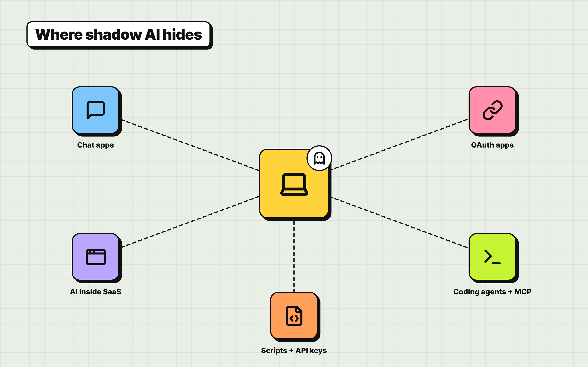

Shadow AI is any AI tool, model or agent used for work without IT or security knowing about it or approving it. It's the AI version of shadow IT, with one big difference: with most SaaS apps the risk is the account, but with AI the risk is also whatever you type, paste or upload into it. And with agents, it's whatever the AI can do on your behalf.

In practice it shows up in five main forms:

- **Chat apps on personal accounts.** ChatGPT, Claude, Gemini and friends, used from a personal login on a work laptop.
- **AI features inside approved apps.** The SaaS tool you already pay for ships an AI assistant, and it gets switched on without a review.
- **AI apps connected through OAuth.** Notetakers, email assistants and writing tools that get read access to calendars, inboxes or Drive with one click.
- **Coding agents, CLIs and MCP servers.** Claude Code, Codex CLI, Cursor and similar tools running with personal API keys and MCP servers nobody reviewed.
- **Scripts that call model APIs directly.** An internal tool or notebook hitting a provider API with a key that lives in someone's `.env` file.

The first two are what most people picture. The last three are where a lot of tools go blind, so keep them in mind as you read the list.

## Why Shadow AI Is a Problem

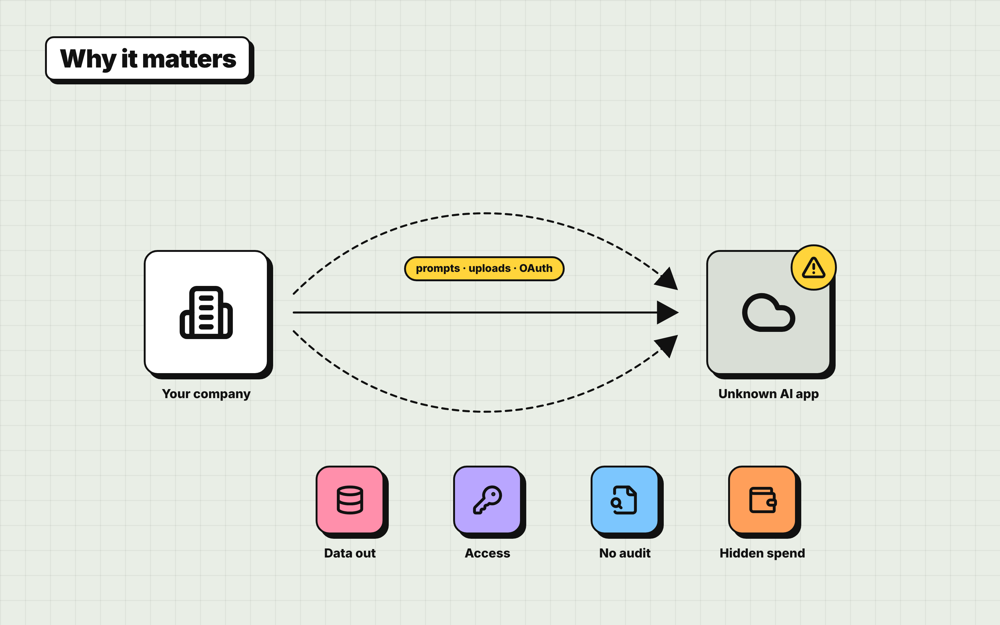

The classic example is Samsung. In 2023, engineers [pasted internal source code into ChatGPT](https://techcrunch.com/2023/05/03/ai-is-just-someone-elses-computer), one asked it to check database code, another fed it a meeting recording for minutes. Samsung's response was to ban generative AI tools for staff entirely.

It hasn't gone away since. IBM's 2026 Cost of a Data Breach research found that [workers using unapproved AI tools figured in 43% of security incidents](https://www.helpnetsecurity.com/2026/07/30/ibm-cost-of-a-data-breach-2026/), more than double the year before. About half of those incidents ended in data loss or compromise, and nearly seven in ten breached organizations had no governance policies covering AI or spotting unsanctioned use.

The risks break down into four buckets:

- **Data leaving the company.** Customer data, source code and contracts end up in prompts and uploads on accounts you don't control.
- **Access you never granted.** An OAuth app or MCP server can read a mailbox or query a database long after the person who connected it forgot about it.
- **No audit trail.** When a customer or auditor asks where their data went, you can't answer.
- **Spend you can't see.** Personal API keys and individual subscriptions get expensed, and nobody has a total.

None of this means AI use is the problem. The problem is AI use you can't see.

## Where Shadow AI Can Be Detected

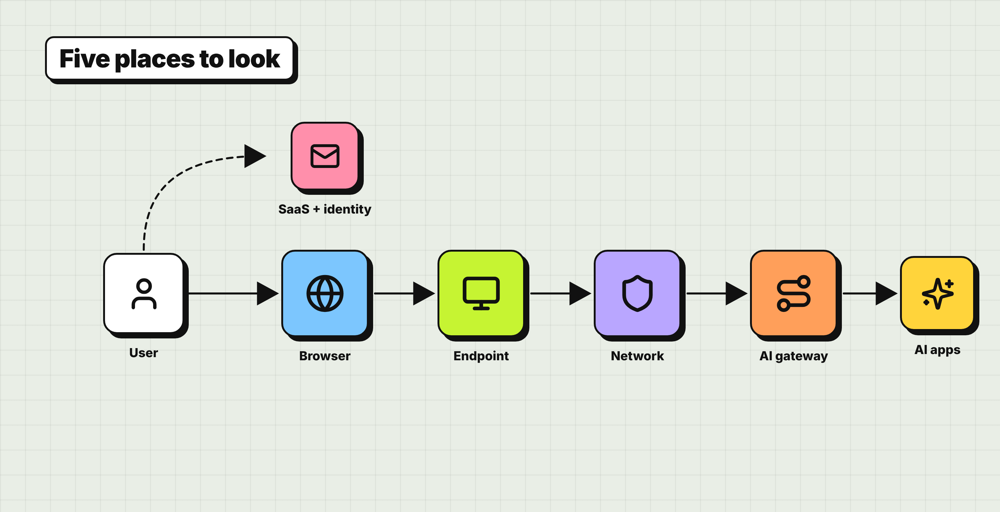

Every tool in this list sees AI use from one or two vantage points, and each vantage point has blind spots. That matters more than any feature list.

| Where it looks | What it catches | What it misses |
| --- | --- | --- |
| **Network (SSE / secure web gateway)** | Traffic to known AI domains from managed devices, including uploads and prompts if traffic is inspected | Devices that aren't routed through it, and AI apps it doesn't recognize |
| **SaaS and identity (email, OAuth, CASB)** | Sign-ups, OAuth grants and app logins tied to work accounts | Anything done with a personal account |
| **Browser** | What users type, paste and upload into AI sites | Desktop apps, CLIs and coding agents |
| **Endpoint** | Desktop AI apps, coding agents, MCP configs and data moving on the device | Unmanaged and personal devices |
| **AI gateway** | Every model and MCP call that goes through it, with the user, key and cost | Traffic that never goes through it |

No single layer catches everything. Most teams combine a discovery layer (to find what's out there) with a governed path (to give people an approved way to use AI).

### How I picked these seven

I chose tools that cover different layers, so you can see the trade-offs side by side instead of seven variations of the same approach. Everything about each tool comes from its own product pages and docs, checked on 24 November 2026. I didn't run them in a lab, so treat the details as what each vendor says it does, and confirm in a trial.

The list isn't a ranking. The right pick depends on which layer you're missing.

## 1. Bifrost – AI Gateway Plus an Endpoint Agent

<!-- PRODUCT SCREENSHOT HERE -->

**Layer:** AI gateway, plus endpoint through Bifrost Edge

[Bifrost](https://docs.getbifrost.ai/features/governance) is an open-source AI gateway. On its own, a gateway only sees traffic you send through it, so it's less a detector and more the approved path you move people onto. The detection part comes from [Bifrost Edge](https://docs.getbifrost.ai/edge/overview), an agent for macOS, Windows and Linux that routes AI traffic from the machine through the gateway.

**Key features:**

- [Virtual keys](https://docs.getbifrost.ai/features/governance/virtual-keys) per team or app that limit which providers and models it can use, with [budgets and rate limits](https://docs.getbifrost.ai/features/governance/budget-and-limits) on top.
- Edge covers the [apps on its supported list](https://docs.getbifrost.ai/edge/supported-applications): Claude Desktop, ChatGPT desktop, Cursor, Codex, Claude Code, Codex CLI, OpenCode, and ChatGPT and Claude on the web.
- An inventory of MCP servers configured in Claude Code, Claude Desktop, Gemini CLI, OpenCode, Codex and Cursor, with allow or deny per server.
- Enterprise [audit logs](https://docs.getbifrost.ai/enterprise/audit-logs) that record who called which model under which key, plus [guardrails](https://docs.getbifrost.ai/enterprise/guardrails) for secrets and PII, and SSO.
- [Log export](https://docs.getbifrost.ai/enterprise/log-exports) to Splunk, Datadog or Elastic.

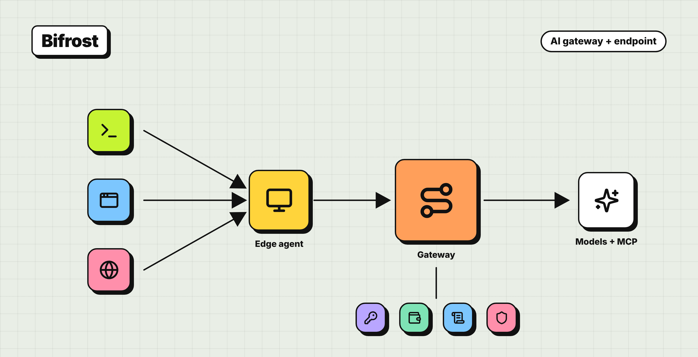

**Best for:** Engineering-heavy teams whose biggest blind spot is coding agents, MCP servers and API keys, and who want detection and the approved path in one place.

**Limitations:** Edge is in alpha, per [Maxim's own write-up](https://www.getmaxim.ai/articles/top-5-shadow-ai-detection-tools-for-2026/), and only covers the apps on its list. It won't find an AI notetaker someone connected through Google OAuth, or AI features inside other SaaS apps.

**Pro tip:** Hand out virtual keys before you roll out Edge. If developers already have a sanctioned key with a sensible budget, routing their tools through the gateway feels like an upgrade, not a crackdown.

## 2. Netskope – AI Discovery Inside a Full SSE Platform

<!-- PRODUCT SCREENSHOT HERE -->

**Layer:** Network (security service edge)

[Netskope](https://www.netskope.com/products/securing-generative-ai) sees AI use the way it sees all cloud traffic: inline, from devices routed through its security service edge. If you already send traffic through it, AI discovery is mostly a matter of turning it on.

**Key features:**

- A Cloud Confidence Index that, per Netskope, covers 370+ generative AI apps among 82,000+ SaaS apps.
- Instance awareness that tells a corporate ChatGPT workspace apart from a personal one, so you can allow one and restrict the other.
- Action-level controls, like stopping uploads or downloads inside an AI app instead of blocking the whole app.
- Coaching messages that point users to the approved tool.
- Real-time DLP on prompts and responses.

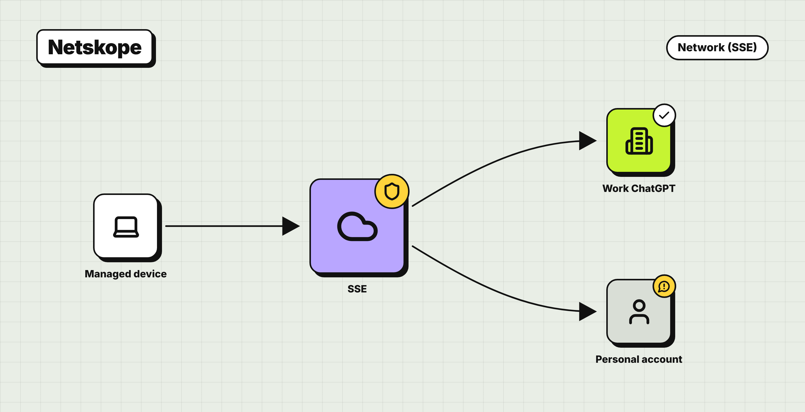

**Best for:** Organizations that already route traffic through an SSE, or plan to.

**Limitations:** It only sees traffic that goes through Netskope, so unmanaged devices are out of view. It's a full security platform, which is a lot if all you want is an AI inventory. The page doesn't say how it handles CLIs, coding agents or MCP servers.

**Pro tip:** Use instance awareness to allow the company ChatGPT workspace and coach on the personal one. Blocking ChatGPT outright just sends people to their phones.

## 3. Microsoft Defender for Cloud Apps – AI Discovery for Microsoft Shops

<!-- PRODUCT SCREENSHOT HERE -->

**Layer:** SaaS / CASB, with endpoint signals

If you're already on Microsoft 365 and Defender, there's a good chance you're paying for AI discovery without using it. [Defender for Cloud Apps](https://learn.microsoft.com/security/security-for-ai/discover) treats AI apps as a category in its cloud app catalog and lets you act on them like any other app.

**Key features:**

- A Generative AI category with more than a thousand AI apps.
- A risk assessment for each app across 90+ factors.
- Sanction or unsanction apps, and set policies that unsanction new AI apps automatically based on risk score or number of users.
- Prompt-level visibility when paired with Purview DSPM for AI.

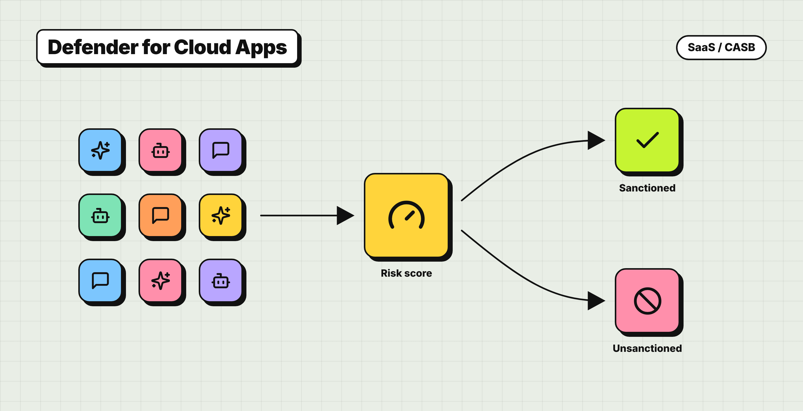

**Best for:** Teams already on Microsoft 365 and Defender, who want AI discovery without another vendor.

**Limitations:** You see apps, not prompts, unless you also set up Purview, which needs devices onboarded to it. Coverage depends on onboarded devices and traffic logs, and the useful parts are spread across several Microsoft products and licenses.

**Pro tip:** Watch the discovered list for a few weeks before you turn on automatic unsanctioning. You'll learn which AI apps teams actually depend on, and avoid breaking someone's workflow on day one.

## 4. Nudge Security – Discovery From Email and OAuth

<!-- PRODUCT SCREENSHOT HERE -->

**Layer:** SaaS and identity

[Nudge](https://nudgesecurity.com/post/ai-discovery-methods-compared) takes a different route from everything else here. Instead of watching traffic, it reads the paper trail every new tool leaves behind in your work inbox.

**Key features:**

- Read-only connection to Google Workspace or Microsoft 365 that scans for sign-up, billing, password-reset and MFA emails.
- Finds AI tools nobody put on a list, including ones from months ago.
- API connections to core SaaS apps that show which AI tools were granted access to company data through OAuth.
- A browser extension for real-time monitoring.

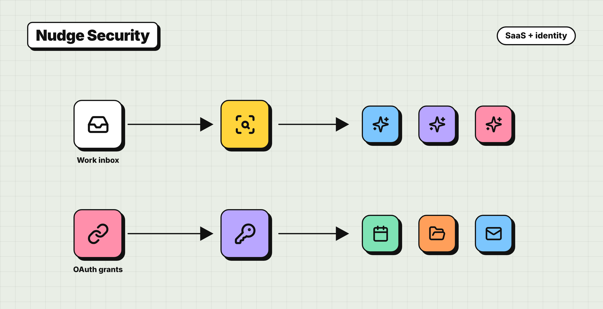

**Best for:** Finding AI sign-ups and OAuth grants on work accounts, like the AI notetaker connected to someone's calendar.

**Limitations:** Nudge's own write-up says email discovery can't see AI used with personal accounts, and API coverage is limited to supported apps. It sees that a tool is in use, not what people type into it, unless the browser extension is installed.

**Pro tip:** Review the OAuth grants first. An AI app with read access to Drive or a calendar is a bigger risk than one somebody signed up for and never used.

## 5. Harmonic Security – What Goes Into the Prompt

<!-- PRODUCT SCREENSHOT HERE -->

**Layer:** Browser and endpoint

[Harmonic](https://www.harmonic.security/solutions/shadow-ai-detection) started as a browser extension focused on what people put into AI tools. In May 2026 it [added an endpoint agent](https://harmonic.security/resources/ai-has-gone-beyond-the-browser-so-has-harmonic), which pushed it past the browser and into desktop apps and coding agents.

**Key features:**

- Coverage of 1,000+ AI apps with prompt-level controls.
- An endpoint agent for desktop AI apps, IDEs, coding agents and direct API calls from scripts on managed machines, plus an MCP gateway.
- Small language models on the endpoint that classify sensitive data in under 200 ms.
- Coach, warn, block or redact before a prompt is sent.
- Restrict personal accounts while leaving approved tools open.

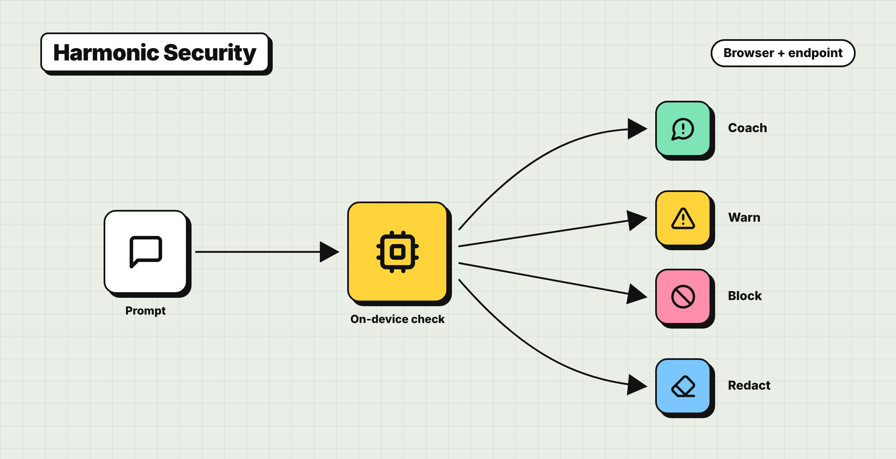

**Best for:** Security teams whose main worry is sensitive data in prompts, who want to coach users rather than block them.

**Limitations:** It only covers managed devices it's deployed to. Its focus is data protection, not model access, budgets or cost.

**Pro tip:** Start in coach or warn mode. A message that explains why a prompt was flagged teaches people faster than a silent block, and it gives you real data before you tighten anything.

## 6. Cyberhaven – AI Discovery Through Data Lineage

<!-- PRODUCT SCREENSHOT HERE -->

**Layer:** Endpoint and data

[Cyberhaven](https://www.cyberhaven.com/product/ai-security) comes at shadow AI from the data side. Its question isn't only which AI tool is in use, but where the data going into it came from.

**Key features:**

- An endpoint inventory of AI tools as they appear: generative AI apps, IDE and CLI coding assistants, agent frameworks and MCP servers.
- A risk score for each tool.
- Usage sorted into sanctioned, unsanctioned, tolerated or restricted.
- Data lineage that traces where data came from before it reached an AI tool, so you know whether that paste came from a customer database or a public doc.
- Block, warn or redact, plus allow-lists for MCP servers.

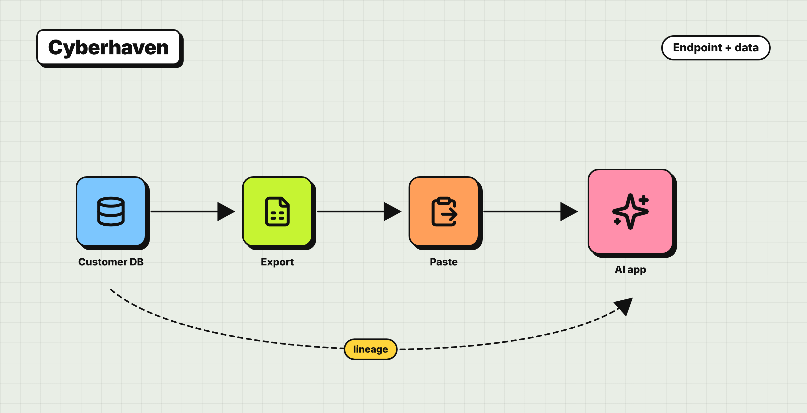

**Best for:** Teams that need to investigate what data reached which AI tool, not just which tools are in use.

**Limitations:** It's a full data security platform with an endpoint agent, so rollout is bigger than a browser extension. It doesn't cover unmanaged devices.

**Pro tip:** Use the tolerated category. Not every tool needs a yes or no on day one, and "fine for now, but watched" is a useful middle ground.

## 7. Nightfall – DLP at the Prompt Box

<!-- PRODUCT SCREENSHOT HERE -->

**Layer:** Browser (with SaaS DLP)

[Nightfall](https://nightfall.ai/solutions/prevent-data-leakage-to-shadow-ai) is a DLP vendor, and its shadow AI coverage sits exactly where data leaves: the prompt box, the upload dialog and the clipboard.

**Key features:**

- A browser plugin that watches prompts, uploads and clipboard pastes into AI apps.
- Visibility into which users or groups try to share which types of data with which AI app.
- Block an upload, or redact only the sensitive part of a prompt and let the rest through.
- Messages that show users why something was flagged.
- Clipboard monitoring on Mac and Windows.

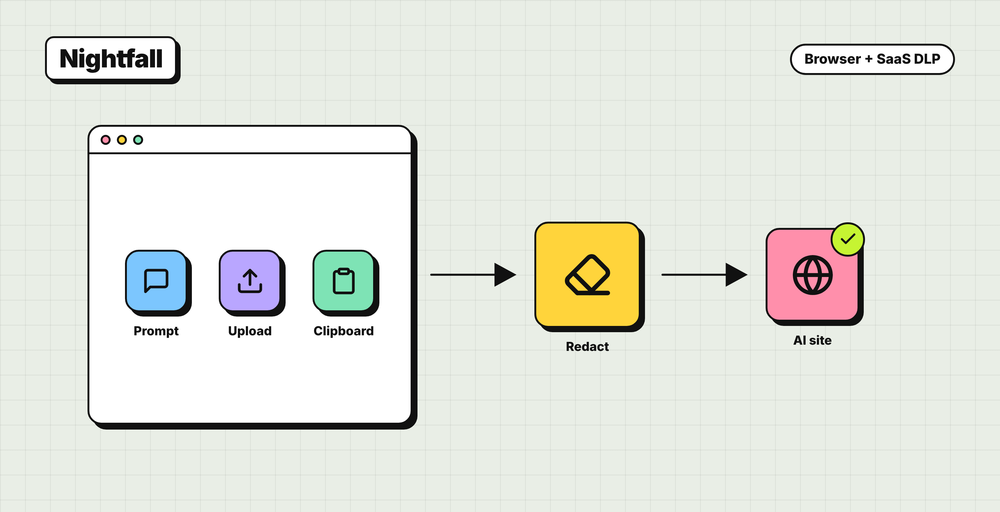

**Best for:** Teams that already think in DLP terms and want to stop sensitive data reaching AI sites without blocking the sites.

**Limitations:** The page focuses on browser AI apps. It doesn't describe coverage for desktop apps, coding agents or MCP, and it's built for data protection more than for building an AI inventory.

**Pro tip:** Lean on redaction over blocking for the common cases. People keep working, and the sensitive bit never leaves.

## Side by Side

| Tool | Where it looks | Sees prompts? | Coding agents and MCP | Main action |
| --- | --- | --- | --- | --- |
| **Bifrost** | AI gateway + endpoint (Edge, alpha) | Yes, for routed traffic | Yes, on its supported list | Route, allow or deny, budget, log |
| **Netskope** | Network (SSE) | Yes, with inline inspection | Not described | Allow, restrict actions, coach, DLP |
| **Defender for Cloud Apps** | SaaS / CASB | With Purview DSPM for AI | Not described | Sanction or unsanction apps |
| **Nudge Security** | Email, OAuth, browser | With the browser extension | Not described | Inventory, OAuth review, nudge users |
| **Harmonic Security** | Browser + endpoint | Yes | Yes | Coach, warn, block, redact |
| **Cyberhaven** | Endpoint + data lineage | Yes | Yes | Block, warn, redact, allow-list MCP |
| **Nightfall** | Browser + SaaS DLP | Yes | Not described | Block, redact, coach |

"Not described" means the product pages I checked don't cover it. It doesn't mean the tool can't do it, so ask in a demo.

## How to Choose

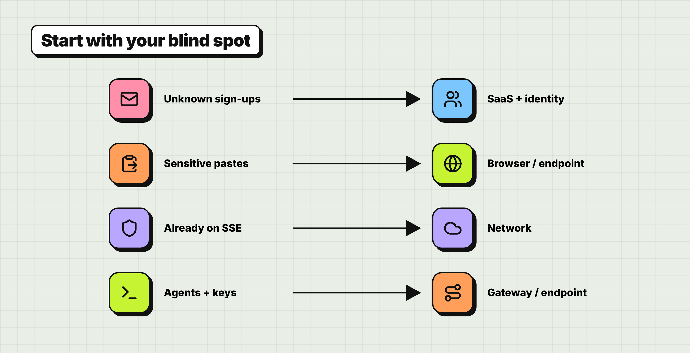

Start with the blind spot that worries you most.

- **"I don't know which AI tools people signed up for."** Start with SaaS and identity discovery: Nudge Security, or Defender for Cloud Apps if you're a Microsoft shop.
- **"I'm worried about what people paste into AI."** Look at the prompt layer: Harmonic, Nightfall or Cyberhaven.
- **"We already run an SSE."** Turn on its AI controls first. Netskope is one example, and Zscaler and Palo Alto offer similar modules.
- **"Our developers run coding agents and MCP servers with their own keys."** Look at the endpoint and gateway layer: Bifrost, Harmonic or Cyberhaven.

Then pair detection with an approved path. Finding 40 AI tools in use only helps if people have somewhere sanctioned to go next. That's usually a company workspace for chat tools, and an AI gateway with per-team keys and budgets for developers and internal apps. Without it, detection just turns into a longer block list, and the cycle starts again.

## How to Roll Out Shadow AI Detection

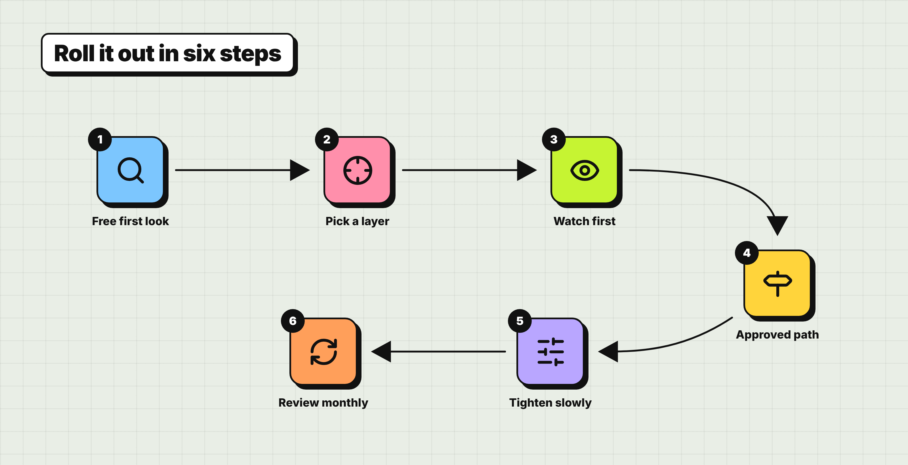

Buying a tool is the easy part. Here's the order I'd do it in, so detection actually changes behavior instead of just producing a scary report.

**1. Get a free first picture.** If you're a small team on Google Workspace or Microsoft 365, start with what you already have: review third-party OAuth grants in your admin console, check which AI domains show up in DNS or firewall logs, and ask people what they use. A short, no-blame survey often surfaces more than you'd expect.

**2. Pick the layer that matches your biggest gap.** Use the "How to Choose" list above. Most teams need one discovery layer to start, not three.

**3. Watch before you block.** Run in monitor or coach mode for a few weeks. You'll learn which tools teams genuinely rely on, and you won't break someone's workflow on day one.

**4. Publish the approved path.** Before you restrict anything, make sure there's a sanctioned option: a company workspace for chat tools, approved keys for developers, and a short list of reviewed AI apps. Tell people where it is.

**5. Tighten gradually.** Move from coach to warn to block for the cases that really matter, like customer data, source code and credentials. Leave everything else on coaching.

**6. Review on a schedule.** New AI tools show up every week. Put a monthly review of the inventory, OAuth grants and MCP servers on the calendar, and update the approved list as you go.

A dedicated tool earns its cost when the list grows faster than you can review it by hand, or when a customer or auditor asks you to prove where their data went.

## Final Thoughts

Shadow AI isn't a sign that people are careless. It's a sign that AI is useful and the approved path hasn't caught up yet. The tools in this list all help, but they help in different places:

- **Know your layers.** Network, SaaS, browser, endpoint and gateway each see a different slice.
- **Find before you fix.** An inventory beats a block list you wrote from guesses.
- **Coach before you block.** People change habits faster when they understand why.
- **Give people somewhere to go.** Detection without an approved path just restarts the cycle.
- **Keep reviewing.** The list of AI tools in use will look different next quarter.

Pick the layer you're most blind in, trial one tool there, and see what it finds.

## Sources

All pages checked on 24 November 2026.

- Samsung: [TechCrunch on the 2023 ChatGPT leak and ban](https://techcrunch.com/2023/05/03/ai-is-just-someone-elses-computer)
- IBM 2026 Cost of a Data Breach: [Help Net Security summary](https://www.helpnetsecurity.com/2026/07/30/ibm-cost-of-a-data-breach-2026/)
- Bifrost: [governance](https://docs.getbifrost.ai/features/governance), [virtual keys](https://docs.getbifrost.ai/features/governance/virtual-keys), [budgets and limits](https://docs.getbifrost.ai/features/governance/budget-and-limits), [audit logs](https://docs.getbifrost.ai/enterprise/audit-logs), [guardrails](https://docs.getbifrost.ai/enterprise/guardrails), [log exports](https://docs.getbifrost.ai/enterprise/log-exports), [Edge overview](https://docs.getbifrost.ai/edge/overview), [Edge supported applications](https://docs.getbifrost.ai/edge/supported-applications)
- Netskope: [securing generative AI](https://www.netskope.com/products/securing-generative-ai)
- Microsoft: [discover AI apps and data](https://learn.microsoft.com/security/security-for-ai/discover)
- Nudge Security: [shadow AI discovery methods](https://nudgesecurity.com/post/ai-discovery-methods-compared)
- Harmonic Security: [shadow AI detection](https://www.harmonic.security/solutions/shadow-ai-detection), [beyond the browser](https://harmonic.security/resources/ai-has-gone-beyond-the-browser-so-has-harmonic)
- Cyberhaven: [AI security](https://www.cyberhaven.com/product/ai-security)
- Nightfall: [prevent data leakage to shadow AI](https://nightfall.ai/solutions/prevent-data-leakage-to-shadow-ai)
